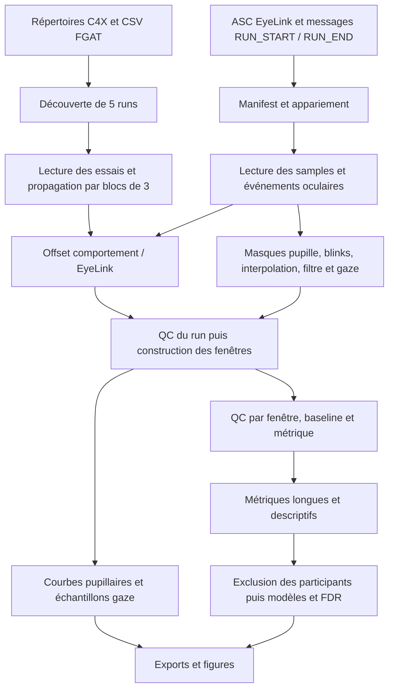

# Audit scientifique et technique du pipeline CREAFFECT

Audit du **3 novembre 2026**, fondé sur la lecture de tous les modules Python,
des tests, des en-têtes ASC disponibles, des tableaux locaux déjà produits et
d'une sélection de publications et de documentations primaires consultées en ligne.
Il s'agit d'une revue ciblée, pas d'une revue systématique exhaustive.

**Verdict sur l'état initial : le projet constitue une base utile pour CREAFFECT, mais ne permet
pas encore de changer de projet en décrivant simplement ses événements,
hypothèses et métriques.** Son organisation modulaire facilite une évolution.
Plusieurs problèmes de calcul et de QC doivent toutefois être corrigés avant
d'en faire un outil générique.

Les constats ci-dessous distinguent les comportements reproduits à l'audit,
les limites de conception et les choix scientifiques à valider. Après cet
audit, une première implémentation a été demandée et réalisée : le
[guide du mode projet](MODE_PROJET.md) et le [changelog](../CHANGELOG_PROJECT_V1.md)
décrivent l'état actuel. Les nombres de la section 2 décrivent toujours les
sorties historiques. Le [grand schéma proposé](../examples/project_spec.proposed.yaml)
reste non exécutable ; utiliser le [projet version 1](../examples/project_example.json).

| Constat de l'audit initial | Première implémentation |
| --- | --- |
| Vitesse pupillaire détectée mais conservée hors des pertes | Rejet corrigé, vitesse calculée sur les deux voisins |
| QC des courbes différent des métriques | Fonction partagée, couverture attendue et bins vides exportés |
| Effectifs avant retrait des ratings | Recalcul après toutes les exclusions requises par le modèle |
| Flux oculaire absent pris pour zéro | Prérequis explicites, exposition et raisons d'indisponibilité |
| Œil et timestamps fractionnaires | Sélection mono/binoculaire, métadonnées et contrôles stricts en mode projet |
| Comptage aux bords et origine de latence | Comptage par onset, latence depuis l'ancre |
| Généralisation | Manifest, événements longs, fenêtres/baselines/ROI/métriques/hypothèses déclarés |

Le script de reproduction exécute le code actuel ; les résultats obtenus
après correction diffèrent donc volontairement des défauts décrits plus bas.

## 1. Fonctionnement actuel



| Étape | Modules | Ce que fait réellement la V2 |
| --- | --- | --- |
| Découverte | `run_pipeline.py`, `matching.py` | Dossiers `C4X###`, CSV `FGAT_Dist_RunN_C4X###.csv`, runs 1–5. Appariement ASC par marqueurs, run 0 ignoré. |
| Comportement | `parsing_behavior.py` | Lit `TIMING` et `FGAT_Dist`, crée les blocs par `trial_n // 3`, propage les variables d'induction, construit les catégories de valence/arousal. |
| EyeLink | `parsing_eyetracking.py` | Lit les trois premières valeurs après le timestamp comme X, Y et pupille ; extrait messages, boutons, fixations, saccades et blinks. |
| Synchronisation | `sync.py` | Premier `BUTTON 1 1` du run associé à `t0_fMRI`, translation d'horloge, contrôle de fin ≤2 s et régularité des boutons. Aucune estimation de dérive entre horloges. |
| Prétraitement | `preprocessing.py` | Valeurs invalides, EBLINK, vitesse près des pertes, padding ±100 ms, rejet d'amplitudes extrêmes, interpolation des trous courts, Butterworth 6 Hz zéro phase sur segments. Masques gaze distincts. |
| Exclusions | `exclusion.py` | Rejette les runs selon synchronisation/pupille ; retient les participants avec ≥2 runs valides. |
| Fenêtres | `moments.py` | Sept définitions propres à CREAFFECT, avec baselines sur la croix précédente. |
| Mesures | `metrics.py`, `timecourse.py` | 17 métriques enregistrées, calculées sur toutes les fenêtres ; export pupillaire par bins de 50 ms pour induction et pré-idée. |
| Analyses | `stats_robust.py`, `stats.py` | Hypothèses H1–H3 fixes ; OLS avec effets fixes participant/run et SE clusterisées par participant ; FDR. MixedLM en option. |
| Rapports | `descriptives.py`, `qc_plots.py`, `viz.py` | Tables QC, distributions, figures par run et heatmaps gaze pondérées par essai puis participant. |

Les fenêtres actuelles sont les suivantes :

| Fenêtre | Début → fin | Nature |
| --- | --- | --- |
| `M1_early_photometric` | Induction +0 → +2 s | Fixe, descriptive |
| `H1_induction_late` | Induction +2 → +10 s | Fixe |
| `H2_pre_idea` | Max(cue, clic −1 s) → clic | Fixe demandée, tronquable |
| `H2_pre_idea_without_motor` | Max(cue, clic −1,2 s) → max(cue, clic −0,2 s) | Sensibilité |
| `H3_liking` | Onset liking → premier mouvement ; validation si celui-ci manque | Variable, avec remplacement implicite de l'endpoint |
| `H3_liking_first_1s_pre_move` | Onset liking → min(onset +1 s, premier mouvement) | Variable, plafonnée |
| `H4_full_search_gaze` | Cue → clic | Variable |

Il existe donc déjà des fenêtres variables. En revanche, leurs règles et leurs
événements sont écrits dans le code. Les listes de durées de sensibilité de
`Config` ne déclenchent pas une exploration automatique.

## 2. Ce qui a été vérifié localement

Le README décrit une validation historique sur un participant. Le dossier
actuellement accessible contient davantage de données :

| Observation | Résultat |
| --- | --- |
| Dossiers participants découverts | 52 |
| En-têtes des ASC directement présents dans ces dossiers | 365 consultés ; tous déclarent `GAZE RIGHT`, 1 000 Hz, `PUPIL DIAMETER`, `FILTER 2` |
| Sorties historiques | Générées le 12 octobre 2026 selon `output/config_used.json` |
| Runs historiques | 181 retenus / 260 attendus |
| Participants historiques | 46 retenus / 52 |
| Raisons d'exclusion de runs | 54 `missing_asc`, 25 dépassements du seuil de pupille manquante, 11 sans pupille utilisable ; les raisons peuvent se cumuler |
| Tests actuels | **8/8 passent** |
| Retraitement frais de C4X001, run 1 | Réussi : 1 445 lignes de métriques, 1 300 bins temporels, écart de fin 6,525 ms, 242 boutons espacés médianement de 1,66 s |

`missing_asc` est un statut du pipeline : il peut signifier absence d'ASC
appariable, y compris ambiguïté, et ne prouve pas qu'un EDF n'existe pas.
Le manifest doit rester la référence pour détailler ces situations.

Les statistiques ci-dessous décrivent les **sorties déjà enregistrées**, sans
nouveau test d'effet de condition :

| Fenêtre | Nombre de fenêtres exportées | Valides pour `pupil_baseline_corrected` | Baseline valide seule |
| --- | ---: | ---: | ---: |
| H1 induction tardive | 895 | 33,3 % | 61,3 % |
| H2 pré-idée | 2 654 | 43,8 % | 67,7 % |
| H3 liking | 2 654 | 35,4 % | 65,4 % |
| H4 recherche entière | 2 654 | 32,7 % | 67,7 % |

Les dénominateurs sont les fenêtres présentes après les exclusions de
participants, pas tous les essais planifiés. Une fraction de runs retenus élevée
ne suffit donc pas à caractériser la quantité de pupillométrie utilisable.

Sur les 181 runs retenus, la fraction moyenne d'artefacts est de 26,4 %, tandis
que la fraction moyenne interpolée est d'environ 0,1 %. L'interpolation médiane
par fenêtre est nulle. Les contrôles des effets des conditions doivent être
complétés par un bilan des exclusions par condition, stimulus, durée et run.

Le Python par défaut du terminal est celui de MRtrix3 et ne contient pas les
dépendances nécessaires. Les vérifications ont utilisé le Python FSL 3.12.3,
avec les packages utilisateur désactivés : NumPy 1.26.4, pandas 2.2.3,
SciPy 1.14.1, statsmodels 0.14.4, matplotlib 3.8.4, seaborn 0.13.2. Pytest était
disponible dans `/tmp/stroop-test-deps`. Ce contexte diffère des versions
enregistrées dans les sorties historiques : ce n'est pas une reproduction
complète de l'environnement d'octobre.

## 3. Problèmes à corriger, classés par priorité

**P1** : peut produire une mesure ou une qualification QC trompeuse.
**P2** : empêche une réutilisation fiable ou rend la mesure ambiguë.
Les reproductions synthétiques se lancent avec :

```bash
python docs/audit/reproduce_findings.py
```

Le script ne lit aucune donnée de participant. Il décrit les comportements
présents sans imposer que ces défauts persistent après correction.

### P1 — vitesse pupillaire détectée mais pas nécessairement rejetée

Dans `preprocessing.py:131`, `speed_artifact` n'est appliqué que dans le
voisinage des échantillons manquants. Un saut rapide, éloigné d'une perte et
d'amplitude compatible avec la distribution globale, reste observé et valide.
La reproduction `speed_outlier_away_from_missing` retourne simultanément
`speed_artifact_mask=True` et `pupil_observed_valid=True`.

Le rejet d'amplitude global ne remplace pas un contrôle de vitesse. Le code
n'implémente pas non plus le rejet des petits îlots isolés ni le contrôle de
déviation à une tendance locale proposés par Kret et Sjak-Shie. Il faut rendre
la méthode explicite et vérifier ses faux rejets sur des traces représentatives.
[Kret et Sjak-Shie, 2019](https://doi.org/10.3758/s13428-018-1075-y).

### P1 — QC différent entre métriques et courbes temporelles

`timecourse.py:32` valide la baseline à partir des seuls échantillons présents.
Il ne vérifie pas sa couverture temporelle comme `metrics._qc_segment`.
Les fractions par bin ont le même problème : 5 samples disponibles sur 50
attendus peuvent donner `observed_fraction_bin=1`. Les bins entièrement absents
ne sont pas exportés. Enfin, les indicateurs `timeout`, `is_resumed` et
`duration_valid` ne sont pas appliqués dans cette fonction.

La reproduction fournit une baseline acquise à seulement 20 % acceptée comme
valide, et un essai `timeout=True` avec des valeurs temporelles finies.
Dans les sorties réelles, **37 220 des 117 642 bins à delta fini proviennent de
fenêtres invalides pour la métrique pupillaire corrigée**. Ce chiffre signale
une différence de politique QC, pas 37 220 valeurs nécessairement fausses.
Le défaut de couverture de baseline, lui, n'a pas été retrouvé dans ces sorties
réelles : aucun de leurs bins à delta fini n'a une baseline invalide selon la
table de métriques.

Correction recommandée : partager une seule fonction de QC et de baseline,
calculer les fractions sur les timestamps attendus, exporter tous les bins
attendus avec `NaN` et des raisons explicites.

### P1 — effectifs des modèles calculés avant le retrait des ratings manquants

Dans `stats_robust.py:27`, `n_rows`, `n_subjects` et les conditions minimales
sont calculés avant `dropna(LTask_rating)`. Ils ne sont pas réévalués ensuite.
La reproduction construit 24 participants dont seulement 2 ont des ratings :
le modèle annonce 24 participants, 720 lignes et `model_reliable=True`, alors
qu'il utilise 2 participants et 60 lignes, en deçà du minimum configuré de 12.

Ce scénario n'a pas été observé pour la mesure H3 corrigée des sorties locales :
les 940 lignes et 46 participants admissibles ont tous un rating. Le défaut
reste important pour la réutilisation sur d'autres données.

Correction : constituer d'abord l'échantillon complet du modèle, puis recompter
participants, lignes, niveaux, variation intra-sujet et rang de la matrice.
Un ajustement OLS qui se termine ne suffit pas à établir `model_reliable=True`.

### P1 — absence d'événements confondue avec un nombre nul

Les blinks et saccades passent essentiellement le QC commun, sans contrôle
explicite de disponibilité de leur flux d'événements ni de leur exposition
de tracking (`metrics.py:478`). Une fenêtre sans événement exporté peut ainsi
donner un taux nul déclaré valide.

La reproduction obtient des taux valides de zéro avec 0 % de gaze valide et
un flux d'événements vide. Dans les sorties locales, **279 fenêtres** ont un
taux de saccades déclaré valide avec 0 % de gaze valide ; 2 781 sont sous 70 %.
Une gaze invalide n'invalide pas automatiquement un blink : un vrai clignement
rend justement le regard non mesurable. Il faut donc un QC adapté à chaque
famille, distinguant fermeture de l'œil, perte technique et flux non enregistré.

Correction : statut explicite `event_stream_present`, métadonnées du détecteur,
temps d'exposition analysable, motif `event_stream_unavailable` si nécessaire.

### P2 — œil sélectionné et format ASC non contrôlés

`Config.eye` n'est pas utilisé. `parse_asc` lit les trois premiers champs,
sans interpréter `SAMPLES`, `PUPIL`, le repère, l'œil, les blocs `START/END`
ou les flags de tracking. Les événements des deux yeux seraient réunis.
La reproduction binoculaire lit une pupille gauche de 1 000 malgré `eye='R'`
et une pupille droite de 2 000.
La reconnaissance des samples exige aussi un timestamp entier : des timestamps
fractionnaires, possibles à 2 000 Hz, seraient ignorés.

**Les 365 ASC inspectés ici sont monoculaires droits : le problème binoculaire
concerne la portabilité, pas une erreur d'œil démontrée sur CREAFFECT.**
Le format EyeLink prévoit une sélection des yeux et plusieurs types d'unités.
[Documentation SR Research](https://www.sr-research.com/download/dispdoc/page25.html).

### P2 — limites des fenêtres et métriques événementielles

Dans `metrics.py:43`, un événement chevauchant deux fenêtres est compté dans
les deux. Un blink 0,8–1,2 s apparaît dans les fenêtres 0–1 s et 1–2 s.
Ce comportement peut convenir à une mesure de présence, mais pas à un comptage
additif d'onsets. Le taux utilise la différence entre premier et dernier
sample, et non la durée demandée ou l'exposition valide. La durée moyenne
d'un blink est rendue égale à zéro lorsqu'aucun blink n'est présent ; elle
est alors non définie et devrait être `NaN`, avec un nombre d'événements nul.

Le pic pupillaire est une valeur absolue. Sa latence est mesurée depuis le
premier sample valide (`metrics.py:185`) : avec un pic à 300 ms et 200 ms
initiales manquantes, la fonction rend 100 ms. Il faut conserver l'ancre nominale.

Convention proposée : fenêtres `[début, fin)`, comptage par onset,
durée de présence par intersection, latence depuis l'ancre déclarée.
Pour des fenêtres volontairement chevauchantes, la réutilisation d'un événement
est attendue et doit être prise en compte dans l'inférence.

### P2 — padding et interpolation presque incompatibles pour un blink ordinaire

Un blink de 120 ms avec padding de 100 ms de part et d'autre produit environ
320 ms à reconstruire. Le plafond actuel de 200 ms empêche son interpolation.
Ce n'est pas une erreur en soi : conserver le trou est un choix conservateur.
En revanche, présenter le traitement comme une reconstruction habituelle des
blinks serait trompeur. Il faut préciser si le plafond porte sur la fermeture
originale ou le trou après padding, puis comparer plusieurs politiques de QC.

### P2 — validité des runs encore dépendante de la pupille pour toutes les familles

Même avec un QC par métrique, `evaluate_run_exclusion` peut arrêter tout le run
sur une pupille constante/inutilisable avant d'extraire le gaze ou les événements.
Le nombre minimal de runs par participant est lui aussi global.
Pour d'autres projets, prévoir des statuts de run/participant par famille de
mesures ; un projet à un seul run ne doit pas exclure tous ses participants.

### P2 — définitions de fenêtres et baselines insuffisamment traçables

H3 remplace le premier mouvement manquant par la validation finale. Ces deux
fenêtres ne mesurent pas exactement la même phase ; l'endpoint utilisé n'est
pas exporté dans `metrics_long`. Aucun cas de ce remplacement n'a été observé
dans les 3 913 essais FGAT des CSV consultés, mais il doit devenir explicite.

Une croix très courte peut fournir une baseline « valide » si sa fraction de
samples est suffisante : il n'existe pas de durée minimale de baseline.
Les bornes absolues, l'ancre, `baseline_source`, la durée demandée, la raison
de troncature et l'endpoint doivent figurer dans une table de fenêtres exportée.

### Autres points de maintenance

- Les champs `max_moment_missing_fraction`, `min_valid_trial_fraction_per_run`,
  `max_sync_drift_ppm_warning` et les listes de sensibilité ne pilotent pas les
  analyses correspondantes. Certains commentaires mentionnent encore 50/60 %
  alors que les valeurs effectives diffèrent. Un paramètre doit être appliqué,
  signalé comme inactif ou retiré.
- `--no-stats` quitte avant les figures de synthèse, y compris heatmaps et
  entonnoirs QC. Seuls les graphiques par run demandés via `--qc-plots` sont
  produits en amont. Séparer les options QC, descriptifs et inférence.
- L'absence de tout dossier participant provoque un accès à une colonne
  `run_valid` inexistante ; un message d'erreur d'entrée serait plus utile.
- Les exceptions de run sont exportées sans traceback détaillé dans les logs.
  Conserver un diagnostic exploitable et une catégorie d'erreur structurée.
- Le dédoublonnage par bornes identiques ne démontre pas l'identité du contenu
  des conversions. Renforcer la provenance EDF/options de conversion et les
  empreintes des contenus effectivement analysés.
- Certaines mesures `moment_valid=True` valent encore `NaN` : 1 154 lignes de
  `saccade_mean_amplitude_deg` dans les sorties existantes. Distinguer QC réussi,
  métrique non définie faute d'événement et calcul échoué.
- La heatmap H4 extrait des samples valides sans appliquer tout le QC de la
  fenêtre gaze. Harmoniser les populations entre cartes et mesures, et afficher
  les effectifs. Une heatmap de samples n'est pas une détection de fixations.
- Les SE clusterisées par participant traitent les dépendances intra-sujet,
  mais pas à elles seules la généralisation à des stimuli partagés entre sujets.
  Les effets fixes participant empêchent aussi l'estimation d'un facteur purement
  inter-sujets colinéaire avec ces effets : le modèle ne peut pas devenir universel.

## 4. Que signifie « gold standard » ici ?

Il n'existe pas de recette unique validée pour tous les paradigmes, ni de jeu
de seuils propre au Long Range Mount qui remplacerait le QC des données.
La synthèse de Mathôt et Vilotijević souligne l'absence de workflow consensuel.
Le choix de prétraitement dépend de la mesure visée et de son analyse.
[Mathôt et Vilotijević, 2023](https://doi.org/10.3758/s13428-022-01957-7).

Le socle recommandé pour ce projet est le suivant. Les valeurs numériques
existantes restent des **candidats à valider**, pas des normes de la littérature.

| Ordre | Traitement recommandé | Application au projet |
| --- | --- | --- |
| 1 | Garder EDF/ASC, commande de conversion et métadonnées d'acquisition | Ajouter provenance, unités, œil, fréquence, filtre du tracker, segments et flags à l'import. |
| 2 | Valider les horloges et ne jamais compresser les interruptions | Séparer les enregistrements interrompus ; conserver les timestamps absolus et les trous. |
| 3 | Marquer les valeurs physiquement/techniquement invalides | Ne pas appliquer des seuils en millimètres à des unités arbitraires. |
| 4 | Traiter blinks, bords, vitesses aberrantes et îlots isolés | Corriger le masque de vitesse, évaluer les autres rejets, exporter chaque masque. |
| 5 | Reconstruire seulement les trous autorisés par le plan | Conserver les masques observé/interpolé ; absence d'interpolation possible pour certaines analyses. |
| 6 | Filtrer/resampler selon la famille de signal | Pupille et gaze séparées ; ne pas utiliser le filtre pupillaire 6 Hz pour détecter des saccades. |
| 7 | Définir événements, baselines et fenêtres | Bornes traçables, durée minimale de baseline, politiques explicites d'événement absent et de troncature. |
| 8 | Appliquer le QC par famille et par métrique | Même règle pour tables et courbes, fractions rapportées au temps attendu. |
| 9 | Inspecter et documenter avant les effets | Traces détaillées, baselines, distributions et exclusions différentielles ; figer les choix et leur justification. |

La correction soustractive est un bon défaut pour la réponse évoquée. Les
baselines artificiellement petites peuvent créer des effets ; la division ou
le pourcentage y sont particulièrement sensibles. Comparer les traces avant et
après correction, et vérifier les baselines elles-mêmes.
[Mathôt et al., 2018](https://doi.org/10.3758/s13428-017-1007-2).

Le filtre actuel 6 Hz est une option défendable pour la pupille, pas une valeur
obligatoire. Comparer des réglages prédéfinis, examiner l'effet sur les pics et
les bords, et conserver une branche peu transformée pour les modèles temporels.
Le zéro phase évite un décalage de phase mais utilise aussi les données futures :
inspecter les effets près des frontières de baseline et des clics. Le binning à
20 Hz est un export, pas une résolution physiologique de 50 ms ni une fréquence
adaptée à toutes les mesures oculomotrices.
Toute décimation doit être précédée d'un filtrage anti-repliement adapté ; un
filtrage par segments exige aussi de qualifier leurs bords et leur longueur.

Pour les GAMM, Fink et al. déconseillent l'interpolation et le filtrage systématiques
qui augmentent l'autocorrélation. Les analyses spectrales, elles, exigent une
gestion explicite de la continuité. Une chaîne unique ne convient donc pas à
toutes les métriques avancées.
[Fink et al., 2024](https://doi.org/10.3758/s13428-023-02098-1).

## 5. Adaptations spécifiques à l'IRM et au Long Range Mount

**Optique et qualité de mesure.** Documenter caméra, lentille, miroir, bobine,
position de tête, œil et changements de configuration. Le Long Range Mount
permet une caméra éloignée ; ses spécifications nominales ne démontrent pas
la précision d'un enregistrement dans votre montage.
[SR Research, EyeLink 1000 Plus](https://www.sr-research.com/eyelink-1000-plus/).
En pratique, ajouter un contrôle des cibles de validation et de la stabilité
entre runs, avec cibles réparties dans la zone réellement présentée.

**Gaze et pupille demandent des étalonnages distincts.** L'erreur de gaze se
mesure sur des cibles connues ; la précision sur des fixations connues, par
exemple avec RMS sample-à-sample et dispersion. La dispersion pendant une
recherche libre ne mesure pas le bruit instrumental. Conserver les paramètres
du détecteur de saccades et les transformations appliquées.
[Dunn et al., édition 2023 publiée en 2024](https://doi.org/10.3758/s13428-023-02187-1).

Les ASC locaux déclarent un **diamètre en unités EyeLink**, pas un diamètre en mm.
En IRM, la géométrie optique peut limiter l'étalonnage physique ; les méthodes de
normalisation demandent alors une description précise. Des effets fixes de sujet
retirent des différences d'intercept, mais ne corrigent pas automatiquement
des différences multiplicatives de grossissement entre personnes/runs.
Conserver les unités natives et décider explicitement d'une éventuelle mise à
l'échelle, avec sensibilité et contrôle de la baseline.
[Steinhauer et al., 2022](https://doi.org/10.1111/psyp.14035).

**Luminance et position du regard.** Pour CREAFFECT, conserver les identifiants
d'image/son est utile, mais ne suffit pas à contrôler leur photométrie. Rassembler
assets et caractéristiques de présentation ; examiner luminance/contraste et
leurs relations avec les conditions. Une fenêtre tardive 2–10 s ne garantit pas
la disparition de l'effet lumineux ni une mesure d'« arousal pur ». Une étude
utilisant le même modèle Long Range à 1 kHz choisissait une tâche auditive pour
éviter les variations de luminance ; c'est un exemple de contrôle expérimental,
pas une recette de prétraitement transférable telle quelle.
[He et al., 2023](https://doi.org/10.1371/journal.pcbi.1011081).

La PFE est une modification apparente de taille liée à l'angle de vue de la
pupille. Une corrélation gaze–pupille est un diagnostic, pas une démonstration
ni une correction suffisante. Les corrections géométriques demandent des
mesures du montage ; une régression non contrôlée peut retirer une part de
l'effet étudié. Pour les degrés de gaze, utiliser la géométrie œil–écran et son
trajet optique via le miroir, et non la distance œil–caméra.
[Hayes et Petrov, 2016](https://doi.org/10.3758/s13428-015-0588-x).

**Synchronisation.** Les intervalles de boutons de 1,66 s sont compatibles avec
un train de triggers régulier dans les sorties locales ; ils ne prouvent pas
à eux seuls leur correspondance aux volumes. Pour le prochain projet, associer
plusieurs ancres indépendantes et ajuster si identifiable :

```text
t_EyeLink = offset + pente × t_référence
dérive_ppm = (pente − 1) × 1 000 000
```

Exporter résidus, incertitude et impulsions manquantes. Si une seule paire
d'ancres existe, qualifier la dérive de non vérifiée. Déclarer les volumes
supprimés/dummy scans et la référence de temps ; la fin du fichier EyeLink
n'est pas une mesure indépendante de synchronisation événement par événement.
Cette recommandation découle du modèle d'horloges, et non d'une preuve de dérive
dans les données présentes.

**Lien avec le BOLD.** Distinguer la synchronisation instrumentale du délai
physiologique. Pour une future intégration IRMf, générer les régresseurs avec
une convention déclarée, une stratégie pour les trous et des facteurs de
confusion adaptés. Ne pas imposer automatiquement un décalage de 4–6 s ou une
HRF unique à toutes les analyses : au repos, Lloyd et al. observent des relations
aux noyaux d'éveil avec des décalages bien plus courts que certaines hypothèses
canoniques. La pupille n'est pas une mesure spécifique du seul locus coeruleus.
[Lloyd et al., 2023](https://doi.org/10.7554/eLife.84822).

**Mouvements oculaires liés au contexte IRM.** Le champ statique peut produire
une stimulation vestibulaire et un nystagmus ; la fixation visuelle et la
configuration expérimentale modulent son expression. Cela justifie une
inspection ciblée si des mouvements périodiques apparaissent, pas une correction
automatique ni l'affirmation que ce phénomène est présent dans CREAFFECT.
[Roberts et al., 2011](https://pubmed.ncbi.nlm.nih.gov/21945276/),
[Ward et al., 2017](https://pubmed.ncbi.nlm.nih.gov/28271407/).

## 6. Catalogue de métriques à rendre configurable

Il faut enregistrer pour chaque mesure : définition, unité, signal utilisé,
besoin de baseline/ROI/géométrie, QC requis, méthode d'intégration et statut
d'interprétation. Les noms seuls ne suffisent pas.

| Famille | Mesures à proposer | Situation actuelle et prérequis |
| --- | --- | --- |
| Pupille descriptive | Moyenne, médiane, SD, quantiles, baseline tonique | Moyenne/SD présentes ; préciser unités, durée et pondération temporelle. |
| Réponse évoquée | Moyenne moins baseline, pic corrigé, latence du pic, pente | Moyenne corrigée/pente présentes ; pic actuel absolu, latence à corriger. Éviter un pic isolé non robuste. |
| Intégrale | AUC signée corrigée, durée intégrée, AUC/durée intégrée | AUC présente et ne franchit pas les grands trous ; durée intégrée à exporter. L'AUC dépend de la durée et n'est pas interchangeable avec une amplitude moyenne. |
| Blinks | Nombre d'onsets, taux, durée moyenne, fraction de fermeture | Taux/durée présents ; préciser exposition, conventions aux bords, événements longs et absence de blink. |
| Saccades | Nombre/taux total, amplitude, durée, pic de vitesse, direction, latence vers cible | ESACC disponibles ; actuellement seuil d'amplitude pour certaines mesures. Contrôler détecteur, précision et exposition. |
| Fixations | Nombre, durées moyenne/médiane, temps de fixation, première fixation | EFIX parsées mais non exploitées pour ces mesures. Définir traitement des événements aux bords et associations aux cibles. |
| AOI/ROI | Dwell time, proportion du temps valide, nombre d'entrées, première entrée/fixation, transitions | Une seule ROI rectangulaire optionnelle actuellement. Ajouter AOI multiples, par stimulus et éventuellement variables dans le temps. |
| Regard spatial | Dispersion, distance à la cible, trajectoire/scanpath | SD X/Y présentes en pixels. Ne pas interpréter comme précision du tracker hors période de fixation connue. |
| QC | Manquants, artefacts, reconstruction, couverture, trous, baselines, erreur de cible | Bonne base existante ; unifier les fonctions et exposer les différences par famille. |
| Avancé | Courbes temporelles, déconvolution, composantes toniques/phasiques, spectre | Courbes seules présentes. Ces analyses exigent leurs propres hypothèses, signaux et contrôles. |

Les AOI et mesures de fixation constituent une extension particulièrement
utile pour la réutilisation ; PupEyes fournit des outils Python pour les
visualiser et calculer nombre et durée de fixations par AOI.
[Zhang et Jonides, 2026](https://doi.org/10.3758/s13428-025-02830-z).

Pour des films ou stimuli mobiles, envisager une classification adaptée à la
poursuite oculaire plutôt que d'assimiler toute période hors saccade à une
fixation. REMoDNaV a notamment été évalué sur des enregistrements de film en IRM.
[Dar et al., 2021](https://doi.org/10.3758/s13428-020-01428-x).

Les microsaccades doivent rester désactivées comme mesure validée tant que la
précision, la détection en vitesse et les contrôles d'artefacts ne sont pas
établis. Un seuil ESACC <1° ne constitue pas cette validation. Les méthodes
classiques exploitent notamment le profil de vitesse et, lorsque disponibles,
les informations binoculaires ; un enregistrement monoculaire ne permet pas
tous ces contrôles.
[Engbert et Kliegl, 2003](https://doi.org/10.1016/S0042-6989(03)00084-1).

Pour les événements rapprochés, la déconvolution peut modéliser le recouvrement
des réponses pupillaires. Elle ne crée pas des informations absentes et demande
une vérification de l'identifiabilité du plan et du noyau de réponse.
[Wierda et al., 2012](https://doi.org/10.1073/pnas.1201858109).

Conventions proposées pour les métriques nouvelles : la première fixation absente
ne doit pas recevoir une latence de zéro ; distinguer absence observée et
censure. Une proportion AOI doit déclarer son dénominateur. Le temps absolu,
le temps valide et une durée ramenée à 0–100 % d'une phase sont des quantités
différentes et doivent rester distinguées.

## 7. Architecture pour réutiliser le pipeline sans réécrire la tâche

La séparation recommandée est :

```text
Adaptateur de données → Enregistrements / événements normalisés
                     → Horloges et métadonnées d'acquisition
                     → Prétraitements par famille
                     → Fenêtres déclarées + QC partagé
                     → Registre de métriques avec prérequis
                     → Hypothèses et modèles déclarés
                     → Tables, courbes et rapport QC
```

**A. Manifest d'acquisitions.** Une ligne par participant × session × run avec
chemins d'ASC, événements et métadonnées. Découverte configurable en option.
Le moteur doit fonctionner avec un run unique, des identifiants alphanumériques,
plusieurs sessions et un projet sans IRM. L'adaptateur CREAFFECT conserve les
règles `C4X`, FGAT et propagation par bloc ; le moteur ne les connaît plus.

**B. Événements normalisés.** Une table longue avec `event_id`, participant,
session, run, essai, bloc si pertinent, `event_type`, `onset`, `duration`, horloge
source, condition et métadonnées arbitraires. Des règles explicites sélectionnent
la première occurrence, la dernière ou une occurrence donnée. L'association
entre deux événements doit être validée dans le même essai/bloc, sans déduction
à partir d'une ligne voisine. L'import peut provenir d'un CSV comportemental,
des MSG EyeLink ou d'une table d'événements externe.

**C. Fenêtres déclaratives.** Prévoir au minimum :

- Intervalle fixe autour d'un onset : stimulus +0,5 → +2 s.
- Intervalle précédant une réponse : réponse −1,2 → −0,2 s.
- Intervalle entre deux événements : cue → réponse.
- Intervalle plafonné par un événement : onset → min(onset +1 s, mouvement).
- Intervalles de bloc et fenêtres glissantes de largeurs/pas prédéfinis.
- Baselines propres à chaque analyse, éventuellement absentes pour une mesure
  tonique, avec politiques d'événement manquant et de troncature.

Une phase de validation doit refuser les unités incompatibles, événements
ambigus, timestamps inversés, baselines postérieures à l'événement et métriques
inconnues. Les paramètres variables doivent produire des `window_id` et
`analysis_variant_id` stables, avec leur rôle principal ou de sensibilité.

**D. Registre de métriques enrichi.** Le décorateur existant est une bonne base,
mais les prérequis ne doivent plus être déduits d'un préfixe `pupil_` ou `gaze_`.
Chaque entrée doit définir famille, unité, baseline nécessaire, type de flux,
géométrie requise, exposition, référence bibliographique et fonction de calcul.
Calculer seulement les mesures demandées pour chaque fenêtre.

**E. Hypothèses séparées de l'extraction.** Décrire variable dépendante,
fenêtre, contraste, unité d'observation, covariables, structure de dépendance,
population admissible et famille de comparaisons. Une hypothèse inter-sujets
ne peut pas employer aveuglément le modèle à effets fixes participant actuel.
Choisir le modèle selon la distribution de la mesure : un compte avec exposition,
une proportion et une amplitude continue n'ont pas les mêmes besoins.

Les fenêtres glissantes, variantes et bins n'autorisent pas des tests temporels
non corrigés. Définir à l'avance la famille de tests et utiliser une procédure
adaptée au temps et à la structure répétée. Les GAMM demandent une modélisation
et des diagnostics de l'autocorrélation, y compris des effets participants/items.
[van Rij et al., 2019](https://doi.org/10.1177/2331216519832483).

**F. Traçabilité complète.** Exporter une table `windows` et une table
`metrics_long` incluant les exclus, puis un indicateur distinct d'admissibilité
pour chaque analyse. Conserver les masques continus ou un cache reproductible.
Ajouter empreinte de configuration/code/inputs, versions et rapport QC avec
traces détaillées. Les exclusions ne doivent pas disparaître avant l'audit.

Le fichier [project_spec.proposed.yaml](../examples/project_spec.proposed.yaml)
illustre ces contrats avec cinq fenêtres, une baseline, des profils QC et une
hypothèse. Il s'agit d'un cahier des charges lisible et vérifiable, **pas d'une
fonctionnalité implémentée ni d'une commande à lancer dans la V2**.

## 8. S'appuyer sur les outils existants

| Outil | Usage pertinent ici | Limite à garder en tête |
| --- | --- | --- |
| MNE-Python | Import EyeLink, annotations oculaires par œil, interruptions d'acquisition et lecture des calibrations | Ne remplace pas l'adaptateur de tâche ni les décisions QC/hypothèses. |
| PupEyes | Prétraitement pupille, visualisation interactive, fixations et AOI dans l'écosystème pandas | Ne constitue pas un moteur universel de statistiques pour tous les projets. |
| eyeris | Référence pour modularité, provenance et rapports QC de pupillométrie | En R ; l'intégration doit être évaluée plutôt qu'imposer un changement de langage. |
| REMoDNaV | Détection adaptée aux signaux gaze prolongés et dynamiques | À valider sur le montage, le bruit et le paradigme ciblés. |

Je recommande d'évaluer **MNE pour fiabiliser l'import**, et PupEyes pour le QC
et les AOI, tout en conservant la couche d'événements/hypothèses propre au projet.
Ces choix sont des recommandations d'architecture, pas des benchmarks réalisés
sur CREAFFECT. MNE conserve les interruptions comme annotations `BAD_ACQ_SKIP`
et peut lire les calibrations ASC.
[Import EyeLink MNE](https://mne.tools/stable/generated/mne.io.read_raw_eyelink.html),
[calibrations MNE](https://mne.tools/stable/generated/mne.preprocessing.eyetracking.read_eyelink_calibration.html).
La publication définitive d'eyeris est disponible en 2026 ; elle apporte une
référence récente de workflow reproductible, sans établir un consensus universel.
[Schwartz et al., 2026](https://doi.org/10.1111/psyp.70375).

Pour l'interopérabilité, viser les conventions BIDS actuelles. La spécification
stable consultée, **BIDS 1.11.2**, décrit explicitement l'eye-tracking sous
`physio`, ses événements, les enregistrements par œil, le repère, les unités et
les métadonnées de calibration. Il ne faut donc plus présenter l'eye-tracking
BIDS uniquement comme une proposition future. La table d'événements de tâche
et les événements physiologiques détectés restent des objets distincts.
[BIDS, physiological recordings](https://bids-specification.readthedocs.io/en/stable/modality-specific-files/physiological-recordings.html).

## 9. Ordre de réalisation conseillé et critères d'acceptation

| Lot | Travail | Critère concret |
| --- | --- | --- |
| 1 | Corriger vitesse, QC temporel partagé, latence et effectifs après filtrage | Les reproductions synthétiques problématiques donnent les comportements attendus ; les résultats CREAFFECT sont comparés avec explication des différences. |
| 2 | Import fiable, métadonnées et flux oculaires vérifiables | Cas mono gauche/droit, binoculaire, aire/diamètre, 500/1 000/2 000 Hz et acquisitions interrompues explicitement traités ou refusés. |
| 3 | Manifest, événements normalisés, fenêtre/baseline déclaratives | Un second projet sans noms C4X/FGAT et avec un seul run passe sans modification du moteur. |
| 4 | Catalogue de métriques et AOI | Mesures demandées seulement ; prérequis manquants expliqués ; unités et dénominateurs exportés. |
| 5 | Hypothèses déclarées et modèles adaptés | Contrastes estimables, effectifs exacts après toutes exclusions, famille de tests connue, diagnostics exportés. |
| 6 | QC interactif, provenance, packaging et environnement verrouillé | Une installation propre et une commande documentée reproduisent un exemple public/synthétique et son rapport. |

Pour CREAFFECT, commencer les sensibilités par les interactions **padding ×
interpolation × couverture observée**, la durée minimale H3 et la baseline.
Les variantes doivent être choisies sur des critères de qualité et de stabilité,
sans sélectionner le réglage donnant la meilleure p-value. Une permutation des
conditions, si utilisée, doit respecter le véritable niveau de randomisation
et les dépendances de blocs/participants.

Le test de portabilité doit couvrir au moins trois scénarios :

1. Une tâche IRM à fenêtres fixes alignées sur des stimuli.
2. Une tâche à réponses et évaluations de durées variables, avec événements
   absents/répétés et timeouts.
3. Une tâche hors IRM avec un seul run, d'autres noms de fichiers et des AOI
   propres aux stimuli.

La réussite signifie changer le manifest, l'adaptateur ou mapping d'événements
et la configuration de projet, **sans modifier prétraitement, QC ou extraction
des métriques**. Elle ne dispense pas de valider les choix scientifiques du
nouveau protocole.

## 10. Références centrales et portée

Les liens scientifiques cités dans les sections précédentes étayent les
recommandations correspondantes. Les plus utiles pour commencer sont :

- [Kret et Sjak-Shie, 2019 — prétraitement et code](https://doi.org/10.3758/s13428-018-1075-y).
- [Mathôt et al., 2018 — baselines et distorsions](https://doi.org/10.3758/s13428-017-1007-2).
- [Steinhauer et al., 2022 — recommandations pupillométriques, dont contexte IRM](https://doi.org/10.1111/psyp.14035).
- [Mathôt et Vilotijević, 2023 — conception, prétraitement et statistiques](https://doi.org/10.3758/s13428-022-01957-7).
- [Fink et al., 2024 — prétraitement et modélisation dynamique](https://doi.org/10.3758/s13428-023-02098-1).
- [Zhang et Jonides, 2026 — PupEyes](https://doi.org/10.3758/s13428-025-02830-z).
- [Schwartz et al., 2026 — eyeris](https://doi.org/10.1111/psyp.70375).

La lecture du code, les huit tests existants, les cas synthétiques et le
retraitement d'un run ne valident pas les inférences de la cohorte entière.
Les images originales, la géométrie optique, les validations de calibration,
les paramètres exacts de détection et les ancres scanner indépendantes restent
à documenter avant de conclure sur certains biais instrumentaux.
