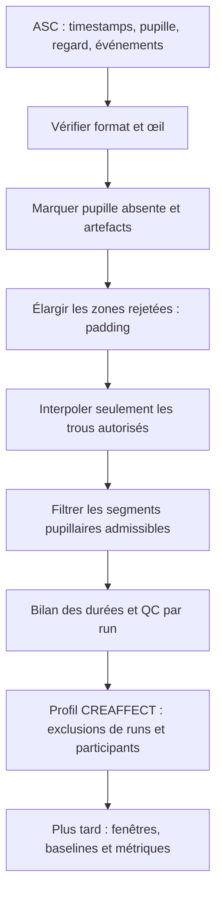

# Présenter le prétraitement eye-tracking à une stagiaire de M2

Support de prise en main, 12 novembre 2026. Le rapport généré par le logiciel
donne les paramètres et les chiffres du lancement concerné ; les seuils ci-dessous
sont les valeurs par défaut actuelles.

## Le message à transmettre en une minute

« L'eye-tracker enregistre où regarde la personne et la taille apparente de sa
pupille. Avant de chercher un effet expérimental, nous vérifions combien de
temps a réellement été enregistré, nous repérons les mesures non fiables, puis
nous mesurons combien de signal reste disponible. Les données reconstruites
restent identifiables. Nous décidons ensuite quels runs et quelles fenêtres
peuvent contribuer à chaque analyse. »

Le premier bilan est **descriptif** : il porte sur les durées et la disponibilité
des données, sans tester une hypothèse de condition.

## 1. Ce qu'il y a dans un fichier EyeLink

Un **échantillon** est une mesure à un instant donné. À 1 000 Hz, on attend
environ un échantillon par milliseconde. Un **run** est une acquisition de la
tâche. Un participant peut avoir plusieurs runs. Le fichier ASC est l'export
texte du fichier EDF de l'EyeLink.

Dans les données CREAFFECT inspectées, chaque sample contient un timestamp,
une position X/Y du regard en pixels et un diamètre pupillaire en unités
EyeLink. Ces unités ne sont pas des millimètres physiques. Les événements
`EBLINK`, `ESACC`, `EFIX` sont les blinks, saccades et fixations identifiés par
le détecteur EyeLink. `MSG` contient les messages de l'expérience.
[Documentation officielle SR Research](https://www.sr-research.com/download/dispdoc/page25.html).

Le profil CREAFFECT apparie les runs avec `RUN_START`/`RUN_END`, et non avec
le seul nom du fichier. Il ignore l'entraînement, run 0. Les acquisitions
manquantes ou ambiguës restent dans le bilan, avec une raison.

## 2. Les durées à distinguer

| Mesure | Signification |
| --- | --- |
| Durée totale ASC | Du premier au dernier sample, plus un pas d'échantillonnage ; inclut les interruptions entre eux |
| Temps acquis | Temps effectivement couvert par les samples présents, sans franchir les grands sauts temporels |
| Temps sans acquisition | Intervalles sans sample dans cette durée ASC |
| Pupille observée conservée | Mesures d'origine retenues après rejet des artefacts, dans le signal nettoyé |
| Pupille interpolée | Temps reconstruit entre deux points valides selon la règle autorisée |
| Pupille inutilisable malgré acquisition | Samples présents mais signal pupillaire encore absent après nettoyage |
| Regard valide | Temps avec positions plausibles sur l'écran, hors blinks et pertes de pupille ; peut recouvrir le temps pupillaire |

La **durée disponible** ne désigne pas forcément un segment continu. Dix
fragments de 1 seconde donnent 10 secondes disponibles, pas une trace continue
de 10 secondes.

Exemple fictif à expliquer au tableau :

| Catégorie | Durée |
| --- | ---: |
| Pupille observée conservée | 450 s |
| Pupille interpolée | 20 s |
| Pupille inutilisable dans les samples acquis | 120 s |
| Temps sans sample | 10 s |
| **Durée totale ASC** | **600 s** |

Ici, 590 s ont été acquises et 470 s de pupille sont disponibles après
nettoyage. La part réellement observée est 450/600 = 75 % de la durée ASC.
L'interpolation n'a pas prolongé l'enregistrement. On ne peut pas ajouter
à ces 600 s le temps de gaze valide ou celui des blinks : ces catégories
se recouvrent avec la pupille.

Un run sans ASC appariable a une durée **inconnue**, pas zéro seconde.
Les sommes de cohorte portent sur les fichiers effectivement mesurés. Les
durées des runs absents et le temps prévu mais jamais enregistré ne peuvent
pas être déduits de ce bilan.

Le CSV donne séparément, lorsqu'elles existent, la durée entre marqueurs
`RUN_START→RUN_END` et la durée comportementale `t_run_end−t0_fMRI`. Les masques
et budgets de signal décrits ici portent sur **tout l'ASC** : l'attente du
scanner ou des marges d'enregistrement peuvent donc y figurer.

## 3. Les étapes du prétraitement



**Lire et vérifier.** Le code choisit l'œil demandé et conserve les timestamps
et les interruptions. Il évite ainsi de prendre une perte d'acquisition pour
une période continûment enregistrée. En mode projet, les en-têtes doivent
permettre de vérifier la fréquence, le repère et l'unité pupillaire.

**Marquer les mesures absentes.** Les valeurs non finies ou ≤0,01 unité
EyeLink sont rejetées. Zéro ne signifie pas une petite pupille physiologique.
La pupille peut être absente pendant un blink ou lors d'une perte de tracking.

**Repérer les artefacts.** Le code calcule la vitesse de changement pupillaire
à partir des deux voisins et de leur distance temporelle. Il rejette les
vitesses extrêmes selon un seuil robuste. L'usage de la vitesse normalisée
et de la MAD, et le retrait des bords de pertes, suivent les principes de
[Kret et Sjak-Shie (2019)](https://doi.org/10.3758/s13428-018-1075-y).

Dans ce code, le seuil de vitesse est `médiane + 6 × 1,4826 × MAD`, avec un
plancher numérique. La MAD est la médiane des écarts absolus à la médiane.
Le rejet supplémentaire d'amplitudes extrêmes utilise aussi une MAD globale.
Ce contrôle global n'est pas le filtre local de tendance de Kret ; le code
ne reprend pas non plus toutes leurs méthodes de rejet des îlots isolés.
Il faut présenter cette chaîne comme une implémentation inspirée des méthodes,
avec des choix explicites, plutôt que comme une reproduction intégrale de l'article.

**Ajouter un padding.** Le masque d'artefacts est élargi de 100 ms avant et
après les blinks, pertes et vitesses rejetées. Cela vise les déformations près
des bords. Le padding ne devient pas du temps de blink : le comptage EBLINK
reste distinct. Le retrait des bords est recommandé ; la largeur précise est
un réglage du projet, et les exemples publiés varient.
[Winn et al. (2018)](https://doi.org/10.1177/2331216518800869).

**Interpoler les petits trous.** Une droite relie deux points valides si le
trou après padding ne dépasse pas 200 ms. Le code ne reconstruit ni les bords
sans points d'appui ni les interruptions d'acquisition. Le masque d'interpolation
reste exporté. Un blink de 120 ms élargi de 100+100 ms représente environ
320 ms : il reste donc absent avec les réglages actuels. C'est un choix conservateur.

**Filtrer.** Un Butterworth d'ordre 4 à 6 Hz, appliqué dans les deux sens,
atténue les fluctuations rapides de la pupille. Le filtre ne remplit pas les
trous et ne traverse pas les segments d'acquisition. Les sous-segments de moins
de 40 samples restent non filtrés. Le filtre pupillaire ne sert pas à détecter
les saccades dans le signal gaze. Les transformations pertinentes dépendent
de l'analyse visée ; le choix 6 Hz n'est pas une norme universelle.
[Fink et al. (2024)](https://doi.org/10.3758/s13428-023-02098-1).

**Inspecter le QC.** Le rapport montre les durées et un extrait du même signal
à quatre étapes : brut, rejet des artefacts, interpolation, filtre. L'extrait
est illustratif et ne démontre pas que tous les runs sont bons. Les courbes
par run et les distributions de pertes servent à vérifier la chaîne sur
plusieurs enregistrements. Les recommandations soulignent cette inspection et
le besoin d'adapter le workflow au protocole.
[Mathôt et Vilotijević (2023)](https://doi.org/10.3758/s13428-022-01957-7).

Le regard est contrôlé séparément : coordonnées finies dans l'écran, sans EBLINK
ni perte de pupille. « Regard valide » ne signifie pas « fixation de la cible »,
ni « attention à la tâche ». Le rapport de temps ne teste pas ces interprétations.

## 4. Exclure une mesure, un run ou un participant : trois décisions différentes

Le rejet d'un sample ne rejette pas automatiquement le run. Une baseline
invalide ne rend pas automatiquement tous les autres types de mesures invalides.
Enfin, le bilan temporel conserve les runs exclus pour documenter les pertes.

| Niveau | Critère par défaut actuel | Conséquence |
| --- | --- | --- |
| Appariement CREAFFECT | ASC/CSV requis indisponible ou marqueurs non appariables | Run exclu de l'analyse ; durée conservée si l'ASC a pu être prétraité |
| Synchronisation CREAFFECT | Synchronisation échouée, notamment écart de fin >2 s | Run exclu ; un bon contrôle de fin ne prouve pas la précision de chaque événement |
| Pupille du run CREAFFECT | Plus de 45 % des samples acquis ont une pupille absente/invalide | Run exclu ; ce taux ne compte pas le padding mais peut inclure les blinks |
| Signal du run CREAFFECT | Aucune pupille nettoyée finie ou moins de 20 valeurs uniques après nettoyage | Run exclu par heuristique technique |
| Participant CREAFFECT | Moins de 2 runs retenus | Participant exclu des analyses de ce profil |
| Fenêtre, plus tard | Timeout/reprise, durée <500 ms par défaut ou couverture <95 % | Fenêtre invalide |
| Pupille d'une fenêtre, plus tard | Observé <70 %, interpolé >20 % ou trou >500 ms | Métriques pupillaires invalides pour cette fenêtre |
| Baseline, plus tard | Durée <500 ms, observé <75 %, acquisition manquante >25 %, couverture <95 % ou définition invalide | Métriques dépendant de la baseline invalides |
| Gaze d'une fenêtre, plus tard | Regard valide <70 % | Métriques gaze/fixation/saccade concernées invalides |

La baseline représente un niveau de référence avant l'événement ; la correction
soustractive sera réalisée lors de l'extraction des métriques, pas pour mesurer
les durées du premier bilan. Une baseline déformée peut créer un effet artificiel,
d'où son contrôle indépendant.
[Mathôt et al. (2018)](https://doi.org/10.3758/s13428-017-1007-2).

**Ces seuils numériques sont des choix du pipeline, pas des prescriptions
universelles des articles.** Ils doivent être examinés sur le QC sans les choisir
en fonction d'une p-value. La table générée `preprocessing_exclusion_criteria.csv`
est la référence pour les valeurs du lancement. Les pourcentages de run et de
fenêtre n'ont pas tous le même dénominateur : samples acquis pour le seuil
global de run, temps attendu pour le QC de fenêtre.

Le mode projet générique ne reprend pas automatiquement les exclusions globales
« 45 % » et « deux runs ». Ses états `recording_processed=True` signifient que
le traitement a fonctionné, pas que toutes les métriques sont scientifiquement
admissibles. Le bilan affiche `not_evaluated` lorsque cette exclusion globale
n'est pas appliquée.

## 5. Lancer seulement la première partie

Depuis la racine du dépôt, dans un environnement disposant des dépendances :

```bash
python run_pipeline.py data --preprocessing-only \
  --output-dir output/bilan_preprocessing_2026-11-12
```

Ajouter `--qc-plots` pour une trace brute/nettoyée par run. Les figures de
cohorte et l'extrait pédagogique sont produits par défaut ; `--no-figures`
permet de ne conserver que les tableaux et le rapport HTML.
Choisir un nouveau dossier de sortie pour chaque comparaison de réglages.

Ce lancement fait l'appariement, le prétraitement, la synchronisation/QC de run
et le bilan de cohorte. Il s'arrête **avant la construction des fenêtres et
les calculs de métriques événementielles ou de modèles**. Pour CREAFFECT, les
CSV comportementaux servent encore à vérifier la synchronisation. Un ASC
prétraité reste décrit même si le CSV comportemental manque.

Avec un projet déclaratif :

```bash
python run_pipeline.py --project mon_projet.json --preprocessing-only \
  --output-dir mes_resultats_preprocessing
```

Dans ce mode limité, les fichiers d'événements et d'ancres d'horloge ne sont
pas lus ; le projet et le manifest doivent rester structurellement valides.
La synchronisation comportementale est alors explicitement non évaluée.

## 6. Fichiers à ouvrir avec la stagiaire

| Fichier | Utilisation |
| --- | --- |
| `preprocessing_report.html` | Support principal de présentation : méthodes, seuils, figures et tableaux |
| `tables/preprocessing_run_summary.csv` | Une ligne par run attendu, durées en secondes et minutes, exclusions comprises |
| `tables/preprocessing_participant_summary.csv` | Nombre de runs et volumes de données par participant |
| `tables/preprocessing_by_run.csv` | Durées cumulées, moyenne, SD, médiane, quartiles, min et max par numéro de run |
| `tables/preprocessing_cohort_summary.csv` | Cohorte entière, runs retenus, puis runs et participants retenus ; trois ensembles imbriqués |
| `tables/preprocessing_steps.csv` | Étapes et paramètres du lancement |
| `tables/preprocessing_exclusion_criteria.csv` | Critères, conséquences et distinction principe/seuil de projet |
| `figures/preprocessing/` | Figures réutilisables pour un diaporama |

Les trois ensembles du bilan de cohorte sont imbriqués : ne pas additionner
leurs durées. Les fractions globales utilisent les durées cumulées comme
dénominateur ; ce ne sont pas les moyennes simples des pourcentages des participants.
Les moyennes de durées de runs sont, elles, calculées run par run.

Pour refaire la présentation à partir de ces sorties, sans relire les ASC :

```bash
python summarize_preprocessing.py output/bilan_preprocessing_2026-11-12 \
  --output-dir output/presentation_preprocessing
```

Les anciens résultats sans durées doivent d'abord être régénérés : le script
ne reconstruit pas des durées fiables à partir des seuls pourcentages QC.

## Proposition de déroulé de présentation, 10–15 minutes

1. Montrer un sample et les canaux pupille/gaze : 2 minutes.
2. Montrer l'extrait à quatre étapes et expliquer les trous qui restent : 4 minutes.
3. Ouvrir un run dans le tableau, puis comparer les numéros de run : 3 minutes.
4. Montrer les exclusions de run, participant et fenêtre : 3 minutes.
5. Revenir à la question scientifique qui nécessitera des fenêtres : 2 minutes.

Trois questions de compréhension : « Pourquoi un zéro brut n'est-il pas une
petite pupille ? », « Pourquoi l'interpolation n'augmente-t-elle pas la durée
de l'ASC ? », « Pourquoi un run retenu peut-il avoir une fenêtre inutilisable ? »

Le support traite la disponibilité technique du signal. La luminance, la
calibration et la géométrie œil–caméra–miroir restent nécessaires pour interpréter
les mesures en IRM ; un signal propre ne constitue pas à lui seul une preuve
d'un effet cognitif. L'[audit scientifique](AUDIT_SCIENTIFIQUE_ET_PORTABILITE_2026-11-03.md)
détaille ces points.
